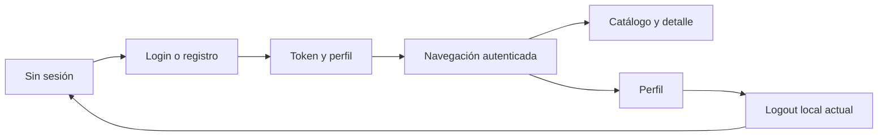
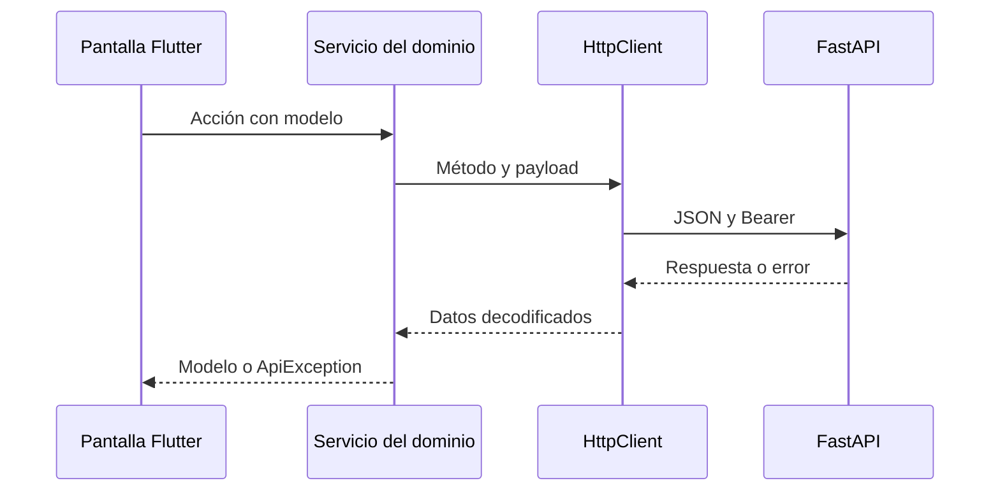

# Directorios y flujos

[Índice](README.md)

| Ruta bajo `lib/` | Responsabilidad |
| --- | --- |
| `main.dart` | Tema/idioma, acceso y navegación actual |
| `core/constants/` | API_BASE_URL y endpoints |
| `core/network/` | Transporte HTTP y token Bearer |
| `core/localization/` | Diccionarios ES/EN y controlador de idioma |
| `core/theme/` | Colores, temas y estado de preferencia |
| `features/auth/models/` | Usuario y credenciales |
| `features/auth/services/` | Registro/login/perfil/logout local |
| `features/auth/screens/` | Acceso y edición de perfil |
| `features/experience/` | Modelos, filtros, servicio, tarjetas, catálogo y detalle |
| `features/booking/` | Reserva, checkout externo, historial, devolución y QR local |
| `features/matching/` | Postulación, disponibilidad y estado sin mutaciones al consultar |
| `features/notifications/` | Bandeja persistente y recuperación de avisos |

Extender una funcionalidad desde su modelo y contrato HTTP; añadir después servicio, estado/pantalla, navegación, traducciones y pruebas. Mantener la autoridad financiera en la API y el transporte común en core/network.
